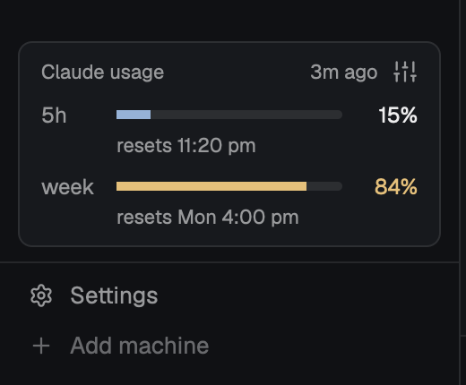

# Claude usage

Herdr's main layout plus a strip above the sidebar footer that shows your Claude plan limits live.
The strip shows how much of your 5-hour and weekly Claude limits you have used and when each one resets, the same numbers as Claude Code's `/usage`.
Its Settings dialog adds real token counts for each Claude Code session in Herdr, alert levels, and your Claude Code sign-in.

## What you see

- The left sidebar, 268 px wide, as in Herdr's main layout: the brand bar, spaces and agents, then the usage strip (a 140 px block), then the footer.
  The rest of the window is Herdr's main layout unchanged.
- The strip is a card in the theme's `surface` color with a 1 px `border`, 8 px corners.
  Its header says "Claude usage", how long ago the numbers last changed ("3m ago") and a settings icon. In a narrow sidebar the title truncates, so the time and the icon always fit.
- Under it, one row per limit: "5h", "week", and "spend" behind a gateway with a spend limit.
  Each row has a 5 px bar, the percentage, and a line under it with the reset time ("resets 11:20pm", "resets Mon 4pm", "resets in 42m"). The line stays on one line: in a narrow sidebar it ends in "…", and its tooltip has the full time ("Resets Mon 4:00 pm").
- Bar colors come from the theme: `accent` below the warn level, `working` from the warn level (80% by default), `blocked` from the urgent level (95%).
- After an hour with no change, the rows dim. After a window resets with no new reply, its row shows "--" and "reset at 11:20pm".
- When a refresh fails, the rows dim and the header says "couldn't refresh" in the `working` color, with the error as its tooltip.
- Instead of the rows, the strip says what's missing, with a button when one helps:
  - "Connect Claude Code to see your plan limits here." [Connect]
  - "Claude Code is signed out." [Log in]
  - "Your limits arrive with your next Claude reply."
  - "This login has no plan limits." (an API key login)
  - "Claude Code isn't installed here."
- The Settings dialog, 720 by 560 px, has a left column in the `chrome` color with Usage and Account.
  - **Usage**: the plan limits again with the time left until each reset, a table of every Claude Code session in Herdr on this computer (session, model, output tokens, input plus cache write, cache read), and the alert levels with minus and plus buttons and a "Sound when urgent" box.
  - **Account**: the Claude account (signed in or out, email, plan, when the login expires) with Log in or Log out, and the Claude Code connection with Connect or Disconnect, the statusline command it sets and the command it still runs.

## How it behaves

- A click on the strip opens Settings on Usage. The settings icon opens Usage, or Account when the strip has no numbers.
- **Where the numbers come from.** After each reply, Claude Code passes `rate_limits` (`five_hour` and `seven_day`, each with `used_percentage` and `resets_at`) to its statusline command. Connect makes that command `tap.sh`, which saves the input to `data/claude-usage/sessions/<session id>.json` in Herdr's folder and then runs your own statusline command, so your statusline looks the same.
- Every session reports the same account-wide limits, and an idle session keeps reporting the numbers from its last reply. So for each window the strip takes the latest `resets_at`, then the highest `used_percentage`.
- The strip reads those files every 10 s, checks the connection every 10 s and `claude auth status --json` every 5 minutes (every 10 s while signed out, and for 2 minutes after Log in or Log out from either view). A failed settings read shows on Account and does not stop the limits refresh.
- When `claude auth status` fails, the strip keeps the last good account, says "couldn't refresh", shows the error on Account and asks again every 10 s.
- The header's age starts at the first reading the strip sees, so the rows dim an hour after the last change even across a restart.
- When the signed-in account (email and org) changes, the strip deletes the saved reports, so another account's limits never show. Sessions report again with their next statusline run.
- **Connect** opens the shipped `confirm` dialog, then edits Claude Code's `settings.json` (in `configDirectory` from `claude auth status`, else `$CLAUDE_CONFIG_DIR`, else `~/.claude`): it saves your `statusLine` to `original-statusline.json` and your command to `original-command` in `data/claude-usage/configs/<config folder>/`, one folder per Claude config folder, then sets the command to `[ -f '<tap.sh>' ] && exec sh '<tap.sh>' '<that folder>'; <your command>`. `tap.sh` runs the command saved in the folder it is given. If the piece is removed, the fallback still runs your command.
- The write follows any symlink to the real file, writes a full copy beside it with `mktemp`, gives it the real file's mode, and renames it into place. A failed write leaves `settings.json` as it was. `data/claude-usage/` is owner-only (700), and the temporary copy there is always removed.
- Each confirmation runs a command unique to the copy that asked (`claude-usage.connect-<id>`), so a dialog the strip opened and one Settings opened never both act.
- **Disconnect** opens `confirm`, then puts the saved `statusLine` back, or removes the key when you had none.
- **Log in** and **Log out** open a tab that runs `claude auth login` or `claude auth logout`, in a space on this computer (the shown one when it is local, else the first local one, else a new local space). Log out asks first. The mod never reads, stores or sends a Claude login.
- **Sessions table**: for each `claude-code` agent in Herdr on this computer, `hc get <terminal> --json` gives the pid of its `claude` process, `~/.claude/sessions/<pid>.json` gives the session id, and the session's transcript gives the tokens: its `.jsonl` plus `subagents/*.jsonl` beside it. Each reply counts once by its message id. The table refreshes every 5 s while the Usage page shows. One `wc -c` call sizes every file, and only files that grew are read again. A click on a row focuses that agent.
- **Alerts**: when a limit crosses the warn or the urgent level, a notification says "Weekly Claude limit at 83%" and when it resets, once per level per limit period, and only while Claude Code is signed in and connected. A click on it opens Settings. The urgent one plays Herdr's `blocked` sound when "Sound when urgent" is on.
- Commands: `claude-usage.settings` and `claude-usage.account` open Settings on that page. Only the strip handles them, so an open dialog never opens a second one.

## Built from

- `layouts/claude-usage.json`: Herdr's `main` layout with a `claude-usage` block (`{ "mod": "claude-usage" }`, 140 px) between `sidebar-lists` and `sidebar-footer`.
- `mods/claude-usage/`: `main.js` (the strip, and the Settings dialog when opened as an overlay), `data.js` (auth status, the connection, the limits, transcript totals), `tap.sh` (the statusline wrapper), Lucide-style icons in `icons/`.
- Shipped mods it uses: `confirm` for Connect, Disconnect and Log out, `toast` through `notify()`.
- `herdr` functions: `exec`, `hc`, `readTextFile`, `agents`, `openOverlay`, `closeOverlay`, `notify`, `playSound`, `shared` and `setShared` (`claude-usage.prefs` for the alert levels, `claude-usage.seen` for when the numbers last changed, `claude-usage.account` for the signed-in account, `claude-usage.authWatch` for when Log in or Log out last ran), `spaces`, `run` (`tab.new`, `space.new`, `agent.focus`).
- Programs: `claude auth status --json`, `claude auth login`, `claude auth logout`, `hc get`, `sh`, `wc`, `tail`, `head`, `find`, `mktemp`, `readlink`, `stat`.

## Watch out

- Anthropic's terms forbid third-party apps from offering a Claude.ai login or from collecting, storing or intermediating Claude.ai credentials. Don't read Claude Code's token from the Keychain or call `api.anthropic.com/api/oauth/usage` with it. Log in and Log out go through Claude Code itself.
- Claude Code's docs list `rate_limits` for Pro, Max and Ultra. Team seats got it too when this was built (Claude Code 2.1.318), but the docs don't promise it.
- `rate_limits` arrives only after a session's first API response, and it only moves when a session replies. Use on claude.ai or another computer shows up with the next local reply.
- Claude Code writes one transcript line per content block, each with the whole reply's usage. Without the message id dedupe, totals come out about twice as high.
- `exec` output stops at 8 MiB and `readTextFile` at 1 MiB. The transcript reader reads 4 MiB chunks from a byte offset with `tail -c` and `head -c`, and skips a line longer than one chunk (a pasted image). It measures that line with `head -n 1 | wc -c`, so the next read starts on a line boundary. A skip by chunk size can land inside a multibyte character, and the decoded text then miscounts the bytes.
- `writeTextFile` replaces a file, which turns a symlinked `settings.json` (dotfiles) into a plain file. `cat >` keeps the link but empties the file first, so a failed write loses every setting. Resolve the link, then rename a full copy over the real file. Connect also refuses when the file changed since it was read.
- `wc -c < missing | tr -d " "` exits 0 with empty output, and `Number("")` is 0. Without an explicit check, a transcript that disappears for a moment reads as truncated and its totals reset to zero.
- Statusline runs overlap: `refreshInterval: 1` with a slow statusline command starts the next run before the last one ends. Every temporary file needs `mktemp`. With a fixed `.tmp` name, 36 of 60 overlapping runs failed to rename.
- A command a `confirm` dialog runs reaches every shown copy of the mod. A fixed name like `claude-usage.connect` lets a cancelled request in one copy act on another copy's confirmation.
- The mod needs `/bin/sh` and the usual Unix tools, so it doesn't run on Windows.
- Connect rewrites `settings.json` with 2-space JSON. A project's own `statusLine` (`.claude/settings.json` in a repo) wins over yours, so sessions in that repo don't report.
- Only agents on this computer are in the sessions table.

## Done when

- `herdr-app check ~/.config/herdr-app/mods/claude-usage` passes.
- Before Connect, the strip says "Connect Claude Code to see your plan limits here."
- After Connect and one Claude reply, the strip shows the same 5h and week percentages as `/usage` in Claude Code, and your statusline looks as it did.
- Disconnect leaves `settings.json`'s `statusLine` exactly as it was before Connect.
- The sessions table lists each Claude Code agent in Herdr, and its output tokens match a count over the transcript that keeps one line per message id.
