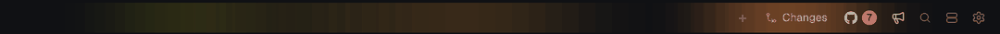
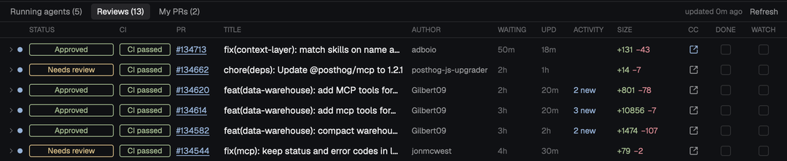
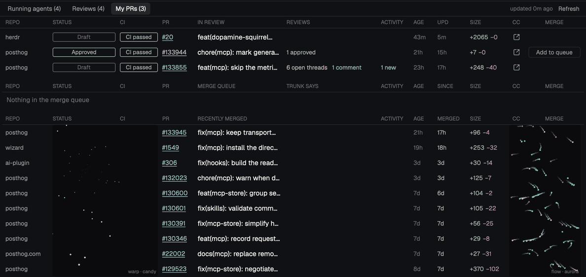

# Dopamine Squirrel 🐿️

Jake Ruth's opinionated, ADHD-proof Herdr setup: one top bar and one panel for everything that pulls your attention. Built for a vertical monitor, fine on a wide one. Always growing; take the parts you like.

```sh
./install.sh enable dopamine-squirrel
```

## Top bar



Review count, a fact-check button (paste a Slack link or screenshot, Claude checks it before you hit send), one-click standup, and a slow neon glow (sped up here).

## Running agents · `cmd-1`


Every agent with its cost, context %, and what it's running in the background (shells, monitors, helpers), grouped by tab. Helpers say whose they are. On top, your Claude plan limits (5h, week, Fable, credits) for each subscription.

## Reviews · `cmd-2`



PRs waiting on you. **DONE** hides one for good, **WATCH** hides it until it changes. **CC** opens Claude on the PR, or resumes your last review of it. Clear the queue for confetti.

## My PRs · `cmd-3`



Your open PRs in any repo, the Trunk merge queue, and what merged this week, with a visualizer for the wins. Click a row to read its comments.

## Keys

| | |
| --- | --- |
| `cmd-1` `cmd-2` `cmd-3` | Running agents, Reviews, My PRs |
| `cmd-b` | Show or hide the panel |
| `cmd-t` `cmd-shift-d` | New pane, straight into Claude |
| `cmd-shift-t` | New tab |
| `cmd-r` | Rename a pane |
| `cmd-w` | Close a pane (asks first) |

## Heads up: some of this is Jake's

These assume Jake's setup. Change them in `~/.config/herdr-app/squirrel.json`, or skip them.

- **Standup button:** Jake's `standup` skill from the PostHog MCP, in his second Claude subscription.
- **CC review button:** Jake's `explaining-prs` skill from the PostHog MCP.
- **Merge queue:** PostHog's Trunk queue and a `PostHog/posthog` checkout.
- **Plan limits:** Jake's two Claude subscriptions.
- **Cloud-task PRs in My PRs:** PostHog cloud tasks, read with your `posthog-cli login`.

---

## For agents

Setting this up or taking a part of it? [RECIPE.md](RECIPE.md) has setup, every setting, the Claude statusline and how the pieces talk to each other.

| Part | Files |
| --- | --- |
| Top bar | `mods/squirrel-topbar/main.js` |
| GitHub fetching (every 5 min, all repos) | `mods/squirrel-topbar/github.js` |
| PRs from PostHog cloud tasks | `mods/squirrel-topbar/cloud.js` |
| Neon glow | `mods/squirrel-topbar/glow.js` |
| Agent cards, context %, cost | `mods/squirrel-panel/agents.js`, `statusline.sh` |
| Plan limits (`/usage` every 10 min) | `mods/squirrel-panel/usage.js` |
| Reviews, triage, CC button | `mods/squirrel-panel/reviews.js`, `table.js` |
| My PRs, merge queue | `mods/squirrel-panel/my-prs.js` |
| Visualizer | `mods/squirrel-panel/visualizer.js` |
| Confetti | `mods/squirrel-confetti/` |
| Pane headers, rename | `mods/squirrel-pane-header/`, `mods/squirrel-rename/` |
| Layout, keys | `layouts/Dopamine-Squirrel.json`, `keys.json` |

What changes colour, since screenshots can't show it:
- Status chips: green when approved or passing, yellow when waiting or running, red when failing or changes are requested.
- Context % and plan limit bars: green, yellow from 50%, red from 80%.
- WAITING turns red after 48 hours. Clicked PR links turn purple.
- A WATCH PR that comes back gets an amber edge and a `↻` tag.
- Remove turns red while waiting for its confirming click.
