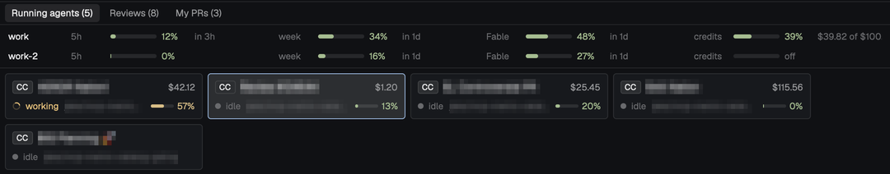
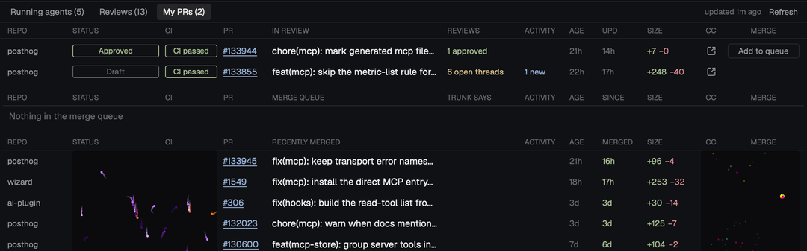

# Dopamine Squirrel 🐿️

Jake Ruth's opinionated, ADHD-proof Herdr setup. Everything that might pull your attention (agents, review requests, your PRs, the merge queue) lives in one top bar and one panel, so nothing slips and nothing nags.

- **Built for a vertical monitor:** a bar on top, the panel under it, panes stacked below. It works on a wide screen too.
- **Pick the parts you like:** scroll through, and each section names the files behind it, so you can point your agent at just that part.
- **Always growing:** I keep adding to it.

Install the whole thing with `./install.sh enable dopamine-squirrel`. Setup, settings and keys are in [RECIPE.md](RECIPE.md).

## ⚠️ Personal to Jake: set these up or skip them

Some buttons are wired to my own tools. They're settings, not code, but out of the box they assume my setup:

| Part | What it expects | How to make it yours |
| --- | --- | --- |
| Standup button (megaphone) | My `standup` skill in the PostHog MCP's project skill store, run in my second Claude subscription | `standupSkill`, `standupCommand` in `squirrel.json` |
| Review button (CC) on Reviews | My `explaining-prs` skill in the PostHog MCP's project skill store | `reviewSkill` |
| Merge queue table and buttons | PostHog's Trunk merge queue, a `PostHog/posthog` checkout, `trunk login` | `posthogCheckout`, or ignore the table |
| Plan limits strip | My two Claude subscriptions | `claudeProfiles` |
| Context % and cost on cards | Claude Code's statusline pointed at this piece's script | [Claude status](RECIPE.md#claude-status) |

PostHog skills load only through the PostHog MCP. Outside PostHog, point those settings at skills you have, or ignore the buttons. Everything else works anywhere with `gh auth login`.

## Top bar

Tabs (hidden when there's only one), a GitHub badge with how many reviews wait on you, a one-click standup, and a slow neon glow behind it all. `cmd-w` asks before closing a pane.

**Grab it:** `mods/squirrel-topbar/`. Glow only: `glow.js`. PR fetching only: `github.js`.

## Running agents (`cmd-1`)

A card per agent with its status, branch, session cost and context %. Sub-agents sit after their parent. Above the cards, one line per Claude subscription: 5-hour, week, Fable and credits, with when each resets.

**Grab it:** `mods/squirrel-panel/agents.js` for the cards, `usage.js` for plan limits, `statusline.sh` for context % and cost.

## Reviews (`cmd-2`)

Every PR waiting on you or your teams, newest first, the ones that name you on top.
- **Triage:** DONE hides a PR for good. WATCH hides it until it changes, then brings it back.
- **CC:** opens Claude on the PR with your review skill. If you closed that pane, it resumes the same conversation.
- **Row:** click it to see who it waits on and the latest comments.
- **Empty queue:** clear the last one and you get confetti.

**Grab it:** `mods/squirrel-panel/reviews.js`, `table.js`, `mods/squirrel-confetti/`.

## My PRs (`cmd-3`)

Your open PRs in every repo, where each stands in the Trunk merge queue, and what merged this week.
- **REVIEWS column:** counts approvals, open threads and comments, so non-blocking notes don't get lost. Click a row to read them.
- **Merge queue:** Add to queue and Remove buttons, each needing a second click to confirm.
- **Visualizer:** the merged rows play a random generative visualizer.

**Grab it:** `mods/squirrel-panel/my-prs.js`. The visualizer alone: `visualizer.js`.

## Small things

- **Pane names:** `cmd-r` renames a pane, and the name shows in its header.
- **Claude panes:** `cmd-t` and `cmd-shift-d` open a pane straight into Claude.
- **Panel:** `cmd-b` shows or hides it, and it sizes itself to its content.

**Grab it:** `mods/squirrel-pane-header/`, `mods/squirrel-rename/`, `keys.json`.
