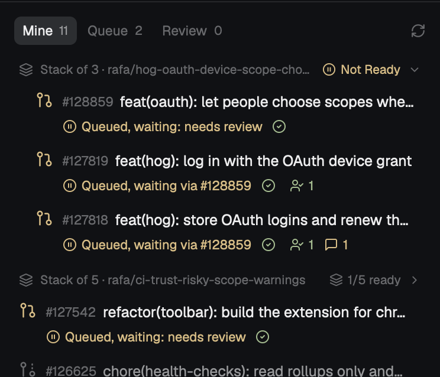

# GitHub and Trunk

Herdr's main layout plus a sidebar panel for your PRs, the merge queue and your reviews.
The panel sits under the agents list: your open PRs grouped into stacks, the Trunk merge queue, and the PRs waiting on your review, each as a tab you can drag into any order.
Rows say what happens next for each PR, and show a button only when something waits on you.

## What you see

- The left sidebar, 372 px wide: the brand bar, then spaces, agents and pull requests stacked at weights 0.8, 1.18 and 1.22, then the footer.
  The rest of the window is Herdr's main layout unchanged: tabs, panes as cards, the Files and Changes panel, the status bar.
- The pull request panel (`gh-inbox`) opens with a tab strip: **Mine**, **Queue** and **Review**, each with a count, and a refresh icon on the right.
- **Mine** lists your open PRs in the PostHog org.
  PRs in a stack sit under a header ("Stack of 3 · top-branch"), top layer first, indented, with the stack's queue state or how many layers are ready.
  `PostHog/posthog` comes first without a header; other repos follow under their name.
- Each row: a PR icon colored by state, `#number`, the title, then a line of chips:
  the next step ("Needs review", "CI 40/52", "2 checks failing", "Changes requested", "Conflicts", "Draft", "Visuals: 3 changed", "Ready to merge", "Queued, waiting: needs review", "Testing 58%", "3rd in line", "Merging", "Merged", "Queue failed"),
  the CI state, the approval count and the unresolved thread count.
  While Trunk tests the PR, a thin progress bar shows checks done out of all of them, and the time since the test started.
- **Queue** lists Trunk's queue for `master`: the queue state, then yours, then Testing (with each batch's progress), Merging, Waiting (numbered), Not ready, Failing, Failed and Recently merged, each folding.
- **Review** lists PRs that ask for your review: "Requested from you", then "Your teams" (folded at first).
- Colors come from the theme: green for ready and passing, red for failing, yellow for waiting on people, the theme's working color for running, magenta for merged.

## How it behaves

- Clicking a row opens the PR on GitHub. Hovering a row shows a copy-link icon and an open icon at the end of its title.
- Buttons appear in a row only when something waits on you:
  "Approve storybook" or "Approve playwright" when visual review found changes (opens the visual review run),
  "Merge" on a ready PR that isn't in a stack, "Merge again" when the queue kicked the PR out,
  and "Merge stack" on a stack header once every layer is ready.
  Merge buttons open the shipped `confirm` dialog, then run `trunk merge <n>` (for a stack, on its top layer).
- A layer that is ready but sits above a layer that isn't says "Waiting on #n below".
- Tabs drag into any order; the order and the selected tab persist per copy.
- GitHub refreshes every 60 s, Trunk every 45 s. A failed refresh keeps the last good data and turns the refresh icon yellow; the error line shows after three failures in a row. An empty search result only replaces a full list when the next refresh agrees.
- Notifications: approved, changes requested, checks failing, visual changes to approve, merged, queue failed or cancelled, and a new direct review request.
- Narrower than 160 px, the panel draws a rail of tab icons with counts.
- Commands: `gh-inbox.show-mine`, `gh-inbox.show-queue`, `gh-inbox.show-review`, `gh-inbox.refresh`.

## Built from

- `layouts/github-and-trunk.json`: Herdr's `main` layout with a `pull-requests` block (`{ "mod": "gh-inbox" }`, min 140 px) added to `sidebar-lists`.
- `mods/gh-inbox/`: `main.js` (the view), `data.js` (the `gh` and `trunk` calls), Lucide-style icons in `icons/`.
  Shipped mods it uses: `confirm` for the merge dialog, `toast` through `notify()`.
- GitHub: one `gh api graphql` search per tab (`author:@me` and `review-requested:@me -author:@me`, both `org:PostHog is:pr is:open archived:false`), reading check counts by state, the review decision, latest reviews, review requests, unresolved threads, mergeability, and the `PostHog Visual Review / <type>` commit statuses.
  Stacks are worked out from head and base branches.
- Trunk: `trunk merge status` for the queue listing, `trunk merge status <n>` for each of your open `PostHog/posthog` PRs, and the GitHub checks of the PR Trunk tests on for progress.
  It runs in the `PostHog/posthog` checkout it finds among the open spaces or common folders, with `trunk` from PATH or that checkout's flox environment.

## Watch out

- `trunk merge status` lists at most 10 items per state, so a PR's own state always comes from `trunk merge status <n>`. Counts at the cap read "10+".
- Trunk prints times in UTC.
- Trunk keys a stack by its top layer; the lower layers say "via #top".
- Cancelled check runs (superseded by a newer push) count apart from failures.
- Herdr refuses a module or an image that resolves outside its folder, so the mod has to be real files there, not symlinks. `install.sh` copies it.
- Without Trunk (no checkout, no CLI, or no `trunk login`), the Queue tab says why and the merge buttons don't show.

## Done when

- `herdr-app check mods/gh-inbox` passes.
- Mine lists your open PostHog PRs, with stacks grouped and the PR you submitted to Trunk showing its queue state.
- Queue matches `trunk merge status`, and Review matches GitHub's review requests.
- Clicking a row opens the PR; the hover icons copy and open its link.
