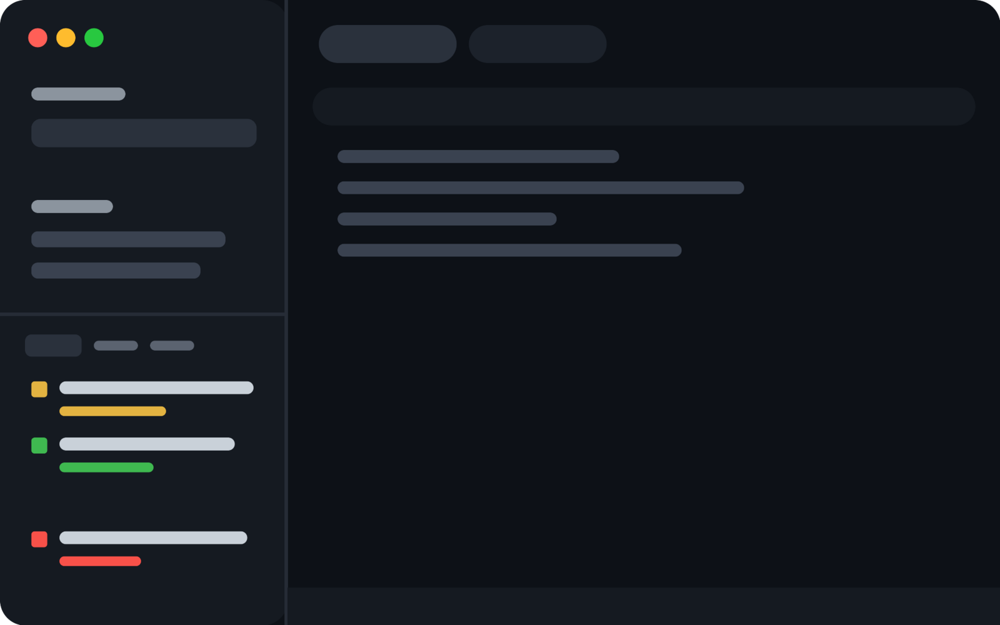

# Gustavo

Gustavo Strassburger's Herdr setup, task-first: each Herdr space is a task with its Claude sessions, pull requests and worktrees. It's built around work on PostHog's Feature Flags team, so some parts expect its tools (hogli, devboxes, the support rotation); take the parts you like. [RECIPE.md](RECIPE.md) describes it in full.



## Install

```sh
./install.sh enable gustavo   # the layout and its mods, from the repo's root
./gustavo/setup.sh            # its themes, key bindings and Claude Code hooks
herdr-app do layout.switch '{"name":"gustavo"}'
```

`setup.sh` moves anything already in the way to `~/.config/herdr-app/.gustavo-backup/<time>/` first, and adds each Claude Code hook to `~/.claude/settings.json` only if it isn't there.

## What's here

| Path | What it is |
| --- | --- |
| `layouts/gustavo.json` | The layout, and `gustavo.svg` its preview |
| `mods/tasks` | Tasks, sessions, PRs, worktrees, the Inbox, Support hero, Slack and alerts, devboxes, setup spaces |
| `mods/hogli` | The hogli sidebar: machine and worktree picker, services (including ones off by default), logs |
| `mods/gh-inbox` | The pull requests panel and the Merge view, started from this repo's `pull-requests` |
| `mods/grafana` | The feature flags numbers on the right, and the Grafana view of its dashboards |
| `mods/dungeon` | The Dungeon view: each task a card with a pixel-art server room and one of PostHog's hoggies per session (working, shouting for you, celebrating, asleep); racks smoke when a PR has a problem; your support hero weeks get a band of tickets on top. The rooms are drawn in code (`art.js`, `room.js`) and baked with `node mods/dungeon/bake.mjs` into `sprites/` and `sprites.js`; the hoggies come from [brand.posthog.com](https://brand.posthog.com) |
| `mods/history` | A bar above the main area with back and forward, like a browser's, and where you are. Keys can run `history.back` and `history.forward` |
| `mods/chrome` | A clone of Herdr's `workspace-chrome`, for the footer without "Add machine" |
| `mods/settings` | A copy of Herdr's Settings with App and Terminals color pickers in Look; opened by the footer and ⌘, |
| `mods/gustavo-menu` | A copy of Herdr's terminal right-click menu: terminals without a pane of their own get Copy, Paste and Close full view; panes have no split or zoom, and Close session |
| `mods/session-head` | The header of a session's pane: session, task, folder, status, restart and close session |
| `mods/gustavo-tabs` | A copy of Herdr's tab bar: a tab's × closes that session only, and unnamed tabs show their agent's title |
| `mods/task-empty` | What a task shows once its last session is closed, so closing a session never closes the task |
| `keys.json` | Herdr key bindings (⌘, opens the Settings copy) |
| `themes/` | The `sand` and `mist` themes |
| `claude/hooks/herdr-task-pr.sh` | Claude Code hook that attaches a PR to its task when `gh pr create` runs; `claude/settings-hook.json` is its entry in `~/.claude/settings.json` |
| `claude/hooks/herdr-claude-session.sh` | Claude Code SessionStart/SessionEnd hook: labels each terminal with its Claude session so the tasks mod runs `claude --resume` there after a reboot |

`mods/settings`, `mods/gustavo-menu` and `mods/gustavo-tabs` are snapshots of Herdr's own Settings screen (`frame/settings`), `mods/menu` and `mods/tabs`. They won't pick up Herdr's later changes: copy Herdr's version again and reapply the changes when they drift.

## Private settings

The parts that point at PostHog's own places read them from `~/.config/herdr-app/data/gustavo/private.json`, which stays out of this public repo. Without it, those parts say what's missing and the rest works.

```json
{
  "grafana": {
    "api": { "us": "<Grafana API address for US>", "eu": "<for EU>" },
    "web": { "us": "<Grafana web address for US>", "eu": "<for EU>" },
    "selectors": {
      "envoy": "<PromQL label matchers for the flags service's envoy cluster>",
      "pods": "<PromQL label matchers for its pods: namespace and pod name>"
    },
    "dashboards": { "home": "<the main dashboard's uid>", "tag": "<the tag of the view's list>", "search": ["<other dashboard titles to list>"] }
  },
  "support": {
    "project": "<PostHog project URL>",
    "view": "<the support tickets view id>",
    "heroSchedule": "<incident.io schedule id>",
    "slackUser": "<your Slack user id>"
  },
  "slack": {
    "app": "<the Slack app id>",
    "alerts": { "id": "<channel id>", "name": "<channel name>" },
    "team": { "id": "<channel id>", "name": "<channel name>" }
  },
  "github": { "team": "<org/team offered as a PR's reviewer>" }
}
```

Tokens live in the login keychain: Grafana's, PostHog's (`ticket:read`), incident.io's and Slack's. The parts that need one show how to add it.

## Save changes

Herdr runs the copies in its config folder. After changing those:

```sh
./gustavo/save.sh
git diff
```

## Not saved

Herdr keeps live state in `~/.config/herdr-app/shared.json`: which PRs belong to which task, nesting, setup spaces, devbox links and the default Claude account. Spaces and sessions live in Herdr itself.
