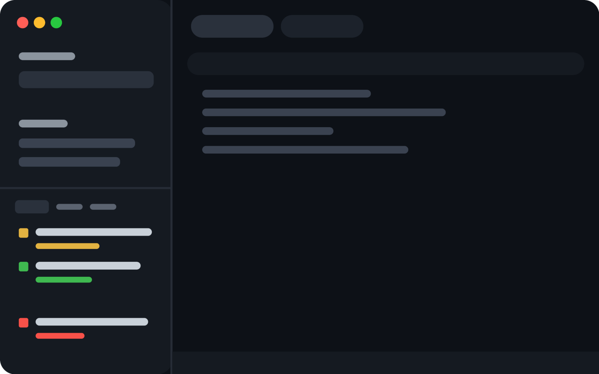

# Gustavo

Gustavo Strassburger's task-first Herdr setup: each space is a task with its Claude sessions, pull requests and worktrees.
A sidebar of tasks, an Inbox of what waits on you, a Grafana view of the feature flags service, a pixel-art Dungeon of your tasks, PostHog's dev stack (`hogli`) on the right, and a history bar to go back and forward.
It's built around one person's work on the Feature Flags team, so some parts expect his tools; take the parts you like.

## What you see

- **Left sidebar** (372 px, `chrome` background): the brand bar; New task and New session; the Claude account new sessions start as; the Work / Inbox / Grafana / Dungeon switch; then the task list.
  - Each task folds open to its sessions (one tab each, side by side when pinned), its pull requests with their CI and review state, and its worktrees.
  - Below the tasks: loose sessions tied to no task, Support hero tickets (in your rotation weeks), your pull requests, worktrees, devboxes, setup spaces and archived tasks.
- **Main area** (`main-stack`, one view at a time):
  - **Work**: the shown session's terminal, each pane with a `session-head` header (session, task, folder, status, restart, close).
  - **Inbox**: sessions that wait on you (blocked, or ended their turn asking you something), PRs asking for your review, firing alerts, and support tickets that wait on the team; beside it, the Merge view of your PRs and the merge queues.
  - **Grafana**: the feature flags dashboards, with the flags service's key numbers.
  - **Dungeon**: one card per task, a pixel-art server room with one of PostHog's hoggies per session: working, shouting for you, celebrating, or asleep.
- **History bar** (34 px, above the main area): back, forward, and where you are (Work › task › session, or Inbox, Grafana, Dungeon).
- **Right sidebar** (480 px): the feature flags numbers for US and EU, and the `hogli` panel: pick a machine and worktree, start the stack, watch its services and logs.
- **Status bar** (28 px): Herdr's `workspace-status`.
- Themes `sand` and `mist`; a terminal right-click menu (`gustavo-menu`) without split and zoom.

## How it behaves

- **Statuses**: a session that ended its turn with a question counts as needing you, though Herdr calls it done or idle: the tasks mod reads its last message (`hc read`) and shares the question as `tasks.asking`. Putting it aside in the Inbox makes it done again until it changes.
- **New task** opens a dialog for Claude's first message (images pasted or dropped), an optional title, and the repo or folder. The task is a space; its sessions are tabs.
- **PRs** join their task when `gh pr create` runs in one of its sessions (the `herdr-task-pr.sh` hook), or by hand.
- **Restart after a reboot**: the `herdr-claude-session.sh` hook labels each terminal with its Claude session; after a reboot the tasks mod runs `claude --resume` in it.
- **Dungeon**: the needs-you cards come first; a card's click goes to its most urgent session. Racks smoke when a PR has failing checks, conflicts or changes asked. The biggest card size that fits is used (3x, 2x, 1x).
- **History**: each place you stay on for 0.7 s joins the history; going back to a closed task or session skips it. `history.back` and `history.forward` can be bound to keys.
- **Support hero**: in your weeks of Team Feature Flags' rotation (incident.io), a section, an Inbox group and a Dungeon band list the tickets that wait on the team.

## Built from

- `layouts/gustavo.json`: the layout. Root row: `sidebar` column (brand, `tasks` parts, `gh-inbox`, footer), `work` column (`history`, a row with `main-stack` and a hidden `panel` stack for files and changes, `workspace-status`), `hogli` column (`grafana`, `hogli` parts, a `hogli` terminal, footer).
- `mods/tasks`: tasks, sessions, PRs, worktrees, Inbox, Support hero, Slack and alerts, devboxes. Parts by `props.part`: `top`, the list, `worktrees`, `setup`, `inbox`, `drop`.
- `mods/gh-inbox`: the pull requests panel and the Merge view (Trunk's and GitHub's merge queues), started from `pull-requests` in this repo.
- `mods/hogli`, `mods/grafana`, `mods/dungeon`, `mods/history`, `mods/session-head`, `mods/task-empty`.
- `mods/chrome`, `mods/settings`, `mods/gustavo-menu`, `mods/gustavo-tabs`: copies of Herdr's `workspace-chrome`, Settings, `menu` and `tabs` with changes.
- Programs: `gh`, `hc`, `git`, `claude`, `python3`, `node` (the Dungeon's `bake.mjs` only), `coder` for devboxes, `hogli` from a PostHog checkout.
- The Dungeon's art: rooms drawn in code (`art.js`, `room.js`) and baked with `node mods/dungeon/bake.mjs` into `sprites/`; the hoggies are PostHog's own, from brand.posthog.com.

## Watch out

- **Private settings**: the places that are PostHog's own (the Grafana addresses, the flags service's metric selectors and dashboards, the support project and view, the rotation's schedule, the Slack channels and app) live in `data/gustavo/private.json` in Herdr's folder, never in this repo. Without it, those parts say what's missing and the rest works. See the README for its keys.
- **Keychain**: the Grafana, PostHog, incident.io and Slack tokens are read from the login keychain; the parts that need one show how to add it.
- `mods/settings`, `mods/gustavo-menu` and `mods/gustavo-tabs` are snapshots of Herdr's own: they won't pick up Herdr's later changes to those.
- Saving in this folder changes nothing: Herdr runs the copies in its config folder. Change those, then `./save.sh` copies them back here.
- `../install.sh` places the layout and mods only. `setup.sh` places the themes, the key bindings (`keys.json` replaces yours, with a backup) and the two Claude Code hooks.

## Done when

- `herdr-app check` passes for every mod in `mods/`.
- `herdr-app do layout.switch '{"name":"gustavo"}'` shows the sidebar, the main area and the hogli column with no errors in `herdr-app status`.
- A Claude session that ends its turn with a question shows "Needs you" on its task, in the Inbox and on its Dungeon card.
- Going to the Inbox and back with the history bar returns to the same task and session.
