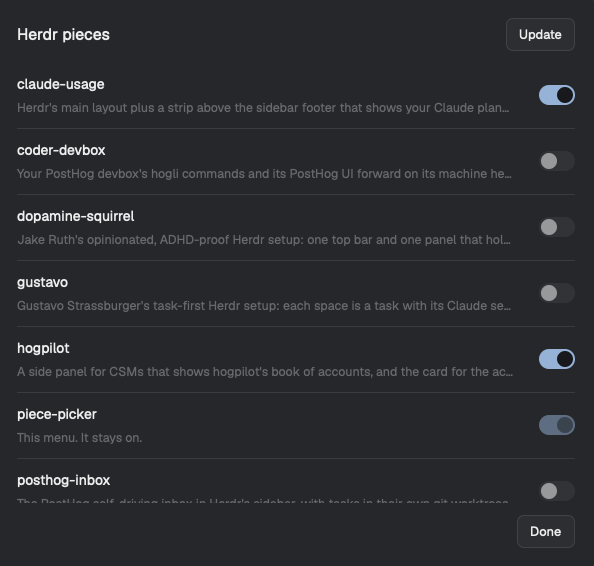

# Piece picker

A dialog with one switch per piece in this repo, so you turn pieces on and off without a terminal.

## What you see

- `mod.open:piece-picker` opens the dialog. This piece's `keys.json` binds it to `cmd-shift-p`, which is Herdr's command palette key. Merge it by hand, and give the palette another key (for example `cmd-k`) if you still want one.
- Herdr's command palette cannot list the dialog. The palette lists only Herdr's own commands and your layouts.
- Each row shows a piece's name, the first sentence of its `RECIPE.md`, and a switch.
- A switch runs `./install.sh enable <piece>` or `./install.sh disable <piece>` in your checkout.
- Update runs `./install.sh`. It pulls the latest and copies what changed, as it does in a terminal.
- Under the list, the dialog shows what `install.sh` reports: key bindings to merge, new pieces, and errors.

## How it behaves

- The dialog finds your checkout through `~/.config/herdr-app/.posthog-herdr-repo`. `install.sh` writes that file after each `update`, `enable` or `disable` that succeeds. The dialog shows the path under its title. If you move or delete that checkout, run `./install.sh` once in the checkout you keep.
- `install.sh` holds a lock, `~/.config/herdr-app/.posthog-herdr-lock`, while it runs `update`, `enable` or `disable`. A second run stops with "Another install.sh is running", in the dialog or in a terminal. The next run clears a lock whose process is gone.
- The dialog gives `install.sh` your Herdr folder through `HERDR_APP_HOME`, and turns off git's password prompt for Update.
- The dialog keeps its own row on, because turning it off removes the dialog while it runs. Use `./install.sh disable piece-picker` to remove it.
- The dialog does not turn off a piece whose layout is on screen. Switch layouts first (`cmd-shift-l`).
- The dialog does not check what a piece needs. Each piece's `RECIPE.md` says that, for example `coder-devbox` needs `pull-requests`.
- If you turn off a piece whose mod your layout still uses, the block stays empty and `herdr-app status` lists the mod as missing.

## What it's built from

- `mods/piece-picker/main.js`: the dialog.
- `mods/piece-picker/pieces.js`: reads the piece list, the summaries and the `install.sh` output. `node --test piece-picker/test/` tests it.
- `install.sh`: the lock, and one line that writes the checkout's path to `.posthog-herdr-repo`.
