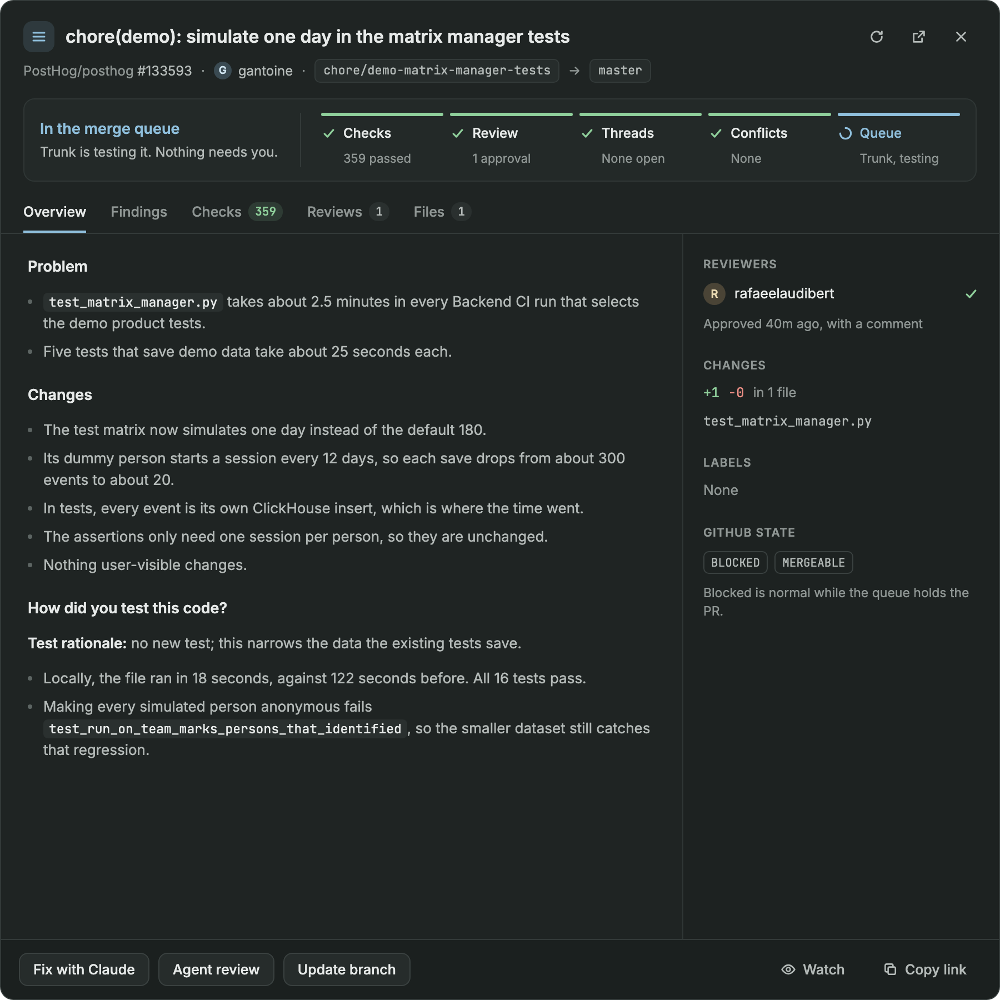
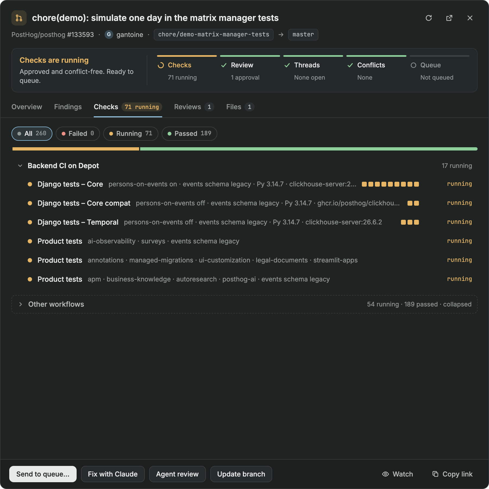
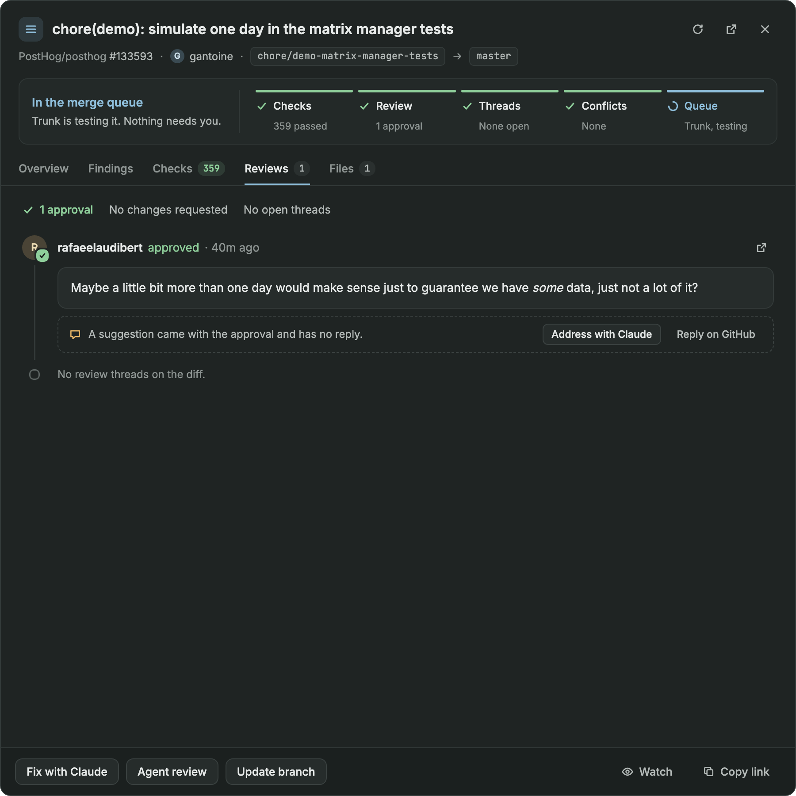
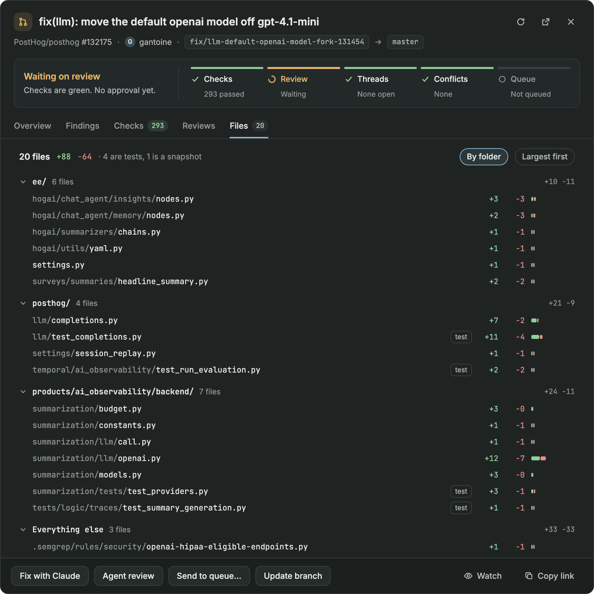

# Pull requests

A PR panel for Herdr's sidebar and a full-page PR workspace: your PRs, the Trunk merge queue and your reviews.
[`RECIPE.md`](RECIPE.md) has how it behaves and what it's built from, and the [repo README](../README.md) has how to install it.

## The PR sheet

Click a PR for its sheet. These are the design mockups the sheet was built from.

| Overview | Checks |
| --- | --- |
|  |  |

| Reviews | Files |
| --- | --- |
|  |  |
