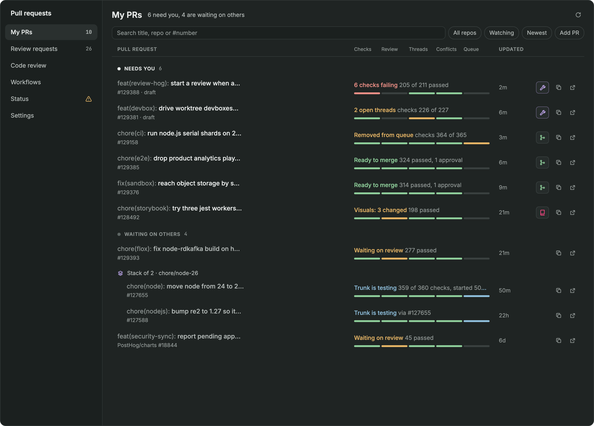
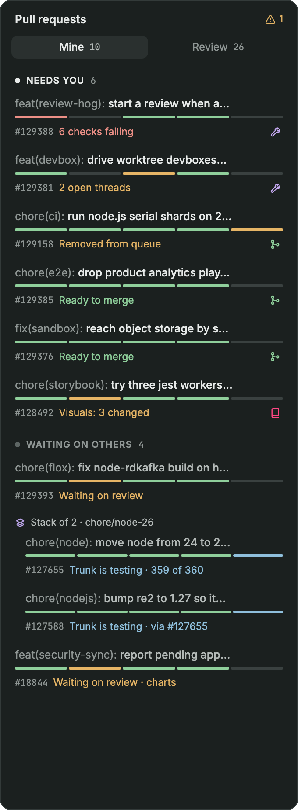
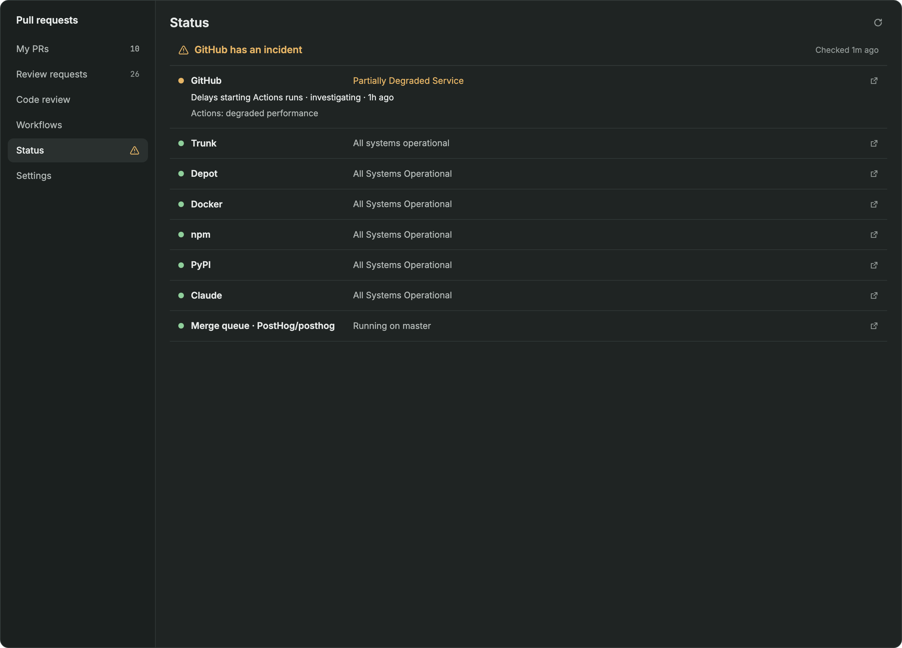

# Pull requests

A PR panel for Herdr's sidebar and a full-page PR workspace: your PRs, the Trunk merge queue and your reviews.
[`RECIPE.md`](RECIPE.md) has how it behaves and what it's built from, and the [repo README](../README.md) has how to install it.

## PR rows

My PRs splits into what needs you and what's waiting on others. Each row has a five-part readiness strip (Checks, Review, Threads, Conflicts, Queue) and shows an action icon only when something is yours to do. These are design mockups.

## Status

The Status page shows whether GitHub, Trunk, Depot, Docker and the other services the work depends on are up. An incident puts a warning on the nav item and in the sidebar's top bar. This is a design mockup with a made-up incident.

## The PR sheet

Click a PR for its sheet. These are the design mockups the sheet was built from.

| Overview | Checks |
| --- | --- |
|  |  |

