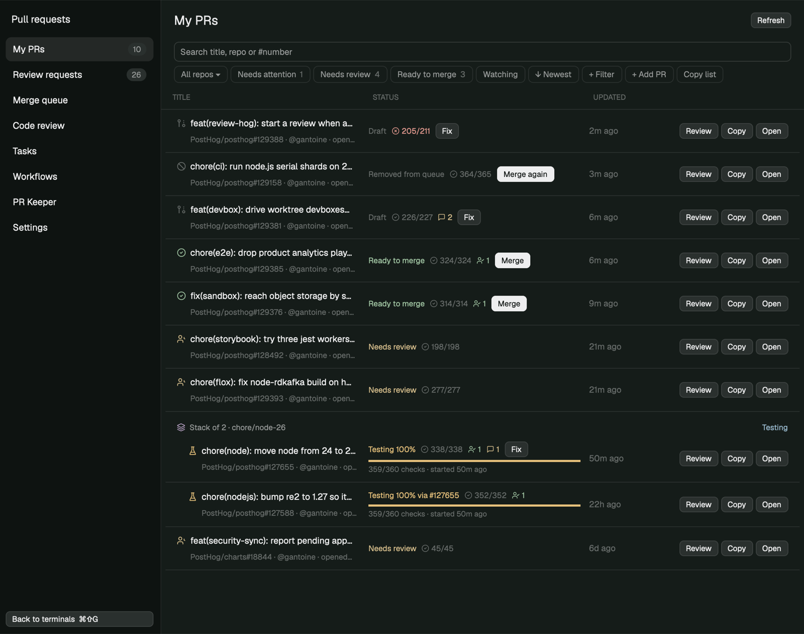

# Pull Requests

Herdr's main layout with a pull request panel and a full-page PR workspace.
The panel sits under the agents list; `cmd-shift-g` swaps the terminals for the full page and back. One mod (`prs`) draws both, and runs agent fixes and reviews on this computer or any Herdr machine.

## What you see

- **The layout, `Pull-Requests`:** Herdr's `main` layout with a 372 px sidebar. The sidebar stacks spaces, agents and the PR panel at weights 0.8, 1.18 and 1.22.
- **`flat-spaces`, a spaces list to opt into:** Herdr's spaces list without the worktree nesting. Every space keeps its own row and avatar, even when its first terminal is in a git worktree, so tabs and panes in one space can each sit in their own worktree. The repo and branch still show after the name. No layout here uses it; set a layout's `spaces` block to `{ "mod": "flat-spaces" }` to use it.
- **The work area:** a stack (`pr-center`) with two children. `work` is Herdr's tabs, panes, Files/Changes panel and status bar, unchanged. `prs-page` is the full PR page. Only one shows at a time; the other keeps running.
- **The sidebar panel:** tabs **Mine**, **Queue** and **Review**, each with a count, then a refresh icon (yellow after a failed refresh) and `⤢` to open the full page. Narrower than 160 px it draws a rail of tab icons with counts.
  - **Mine** groups your open PRs by repo. The first configured repo has no header; the others follow under their name.
  - **Stacks:** PRs in a stack sit under "Stack of N · top-branch", top layer first and indented. The header shows the stack's Trunk state, or "k/N ready", and "Merge stack" once every layer is ready.
  - **Rows:** each row is a state icon, `#number` and the title. Under it is the next-step chip ("CI 40/52", "2 checks failing", "Conflicts", "Changes requested", "Needs review", "Visuals: 3 changed", "Ready to merge", "Queued, waiting: …", "Testing 58%", "3rd in line", "Merging", "Merged", "Queue failed", "Waiting on #n below"), followed by checks passed/total, approvals and unresolved threads.
  - **Testing progress:** while Trunk tests a PR, a thin bar shows checks done out of the total, and the time since the test started.
  - **Queue** lists Trunk's queue in folding sections: Yours, Testing, Merging, Waiting (numbered), Not ready, Failing, Failed, and Recently merged (folded at first). Counts at Trunk's 10-item cap read "10+".
  - **Review** lists PRs waiting on your review under "Requested from you" and "Your teams" (folded at first), each sorted by priority with one reason label ("Unblocks others 3", "Last approval", "Quick (14 lines)", "Waited 36h", …). PRs you hid fold into "Hidden".
- **The full page:** a 230 px nav (My PRs, Review requests, Merge queue, Code review, Tasks, Workflows, Settings, and "Back to terminals ⌘⇧G" at the bottom), then the page's title, search, filter chips and a table.
  - **Tables:** My PRs and Review requests have Title, Status (or Requested) and Updated columns, plus Review/Copy/Open buttons on every row. They use the sidebar's icons, chips, stack headers and progress bars.
  - **Filter chips:** repo, Needs attention, Needs review, Ready to merge, Watching, newest/oldest, requested via (direct or a team), Priority, saved filters, "+ Filter", "+ Add PR" and Copy list.
- **The detail sheet:** an 880×760 dialog with Overview, Findings, Checks, Reviews and Files.
  - **Overview:** actions, status, merge state, queue, size, open threads, labels, failing checks and the description.
  - **Checks:** tiles for passed, running and failed, then every check with a REQUIRED tag where it applies.
  - **Reviews:** review cards, then threads (unresolved first) with Resolve and Open.
- **Settings page:** repositories (add, reorder, remove), where agents run, a checkout path per repo with Detect, the Trunk repo and the machine its CLI runs on, agent models and notifications.
- **Colors:** all from the theme, through named tones: ok `ansi2`, bad `ansi1`, warn `ansi3`, run `working`, merged `ansi5`, info `ansi6`, plus `accent`, `muted` and `dim`. Light themes and theme picks apply to both views, since they're one layout.

## How it behaves

- **Opening things:** click a row for the detail sheet, and right-click for the full action menu.
- **Row buttons:** they appear only when something waits on you:
  - "Approve storybook" or "Approve playwright" opens the visual review run.
  - "Merge" shows on a ready PR outside a stack, and "Merge again" when the queue removed it.
  - "Merge stack" shows on a stack header.
  - "Fix" shows on your PR when it has conflicts, failing checks, changes requested or unresolved threads.
  - Merge and Approve ask first. Merging a PR in the Trunk repo runs `trunk merge <n>`, and falls back to a `/trunk merge` comment when the Trunk CLI isn't available. Other repos use `gh pr merge --squash --match-head-commit`, and approvals are pinned to the head commit shown, so a push after the last refresh is never merged or approved unseen.
- **Agents:** they run on the machine set in Settings (this computer by default).
  - **Fix with Claude:** opens a Claude Code tab in a worktree of the PR branch (`~/.herdr/worktrees/prs/<repo>-<n>` on that machine). The prompt asks it to resolve threads, get CI green and merge the base in, and to show you what it will push before pushing.
  - **Agent review:** runs in the background (`hc run --bg`). Four read-only `claude -p` lenses (correctness, security, reliability, tests) look at a detached worktree of the PR head, then a judge drops what the code doesn't support. Runs are limited to Read, Grep and Glob inside the PR worktree and the run's folder (symlinks out are refused too), load no settings files, hooks or MCP servers, and fail the run if any reviewer or the judge exits with an error. Findings land in Code review and the sheet's Findings tab, where you can dismiss or restore them, fix them in Claude, or post them as a PR comment.
  - **Review in Claude:** opens an interactive session for someone else's PR, told not to post anything.
- **Other actions:** update branch, rerun failed checks (`gh run rerun --failed`), resolve a thread, approve, watch, hide a review request, copy a Markdown link, open on GitHub.
- **Workflows:** when *trigger* (PR opened, checks passed or failed, approved, changes requested, conflicts, behind, ready, label added, review requested, …) and *conditions* (repos, only mine, draft, labels, base branch, title), then *actions* (labels, comment, request reviewers, notify, merge, agent review, fix session). A failed action is retried from that step on the next refresh, up to three times.
  - They're checked on each refresh while Herdr is open, at most 5 runs per PR per hour.
  - The first refresh after install only records state, so nothing fires on existing PRs.
- **Refresh:** GitHub every 90 s for your PRs and 180 s for reviews, Trunk every 45 s, agent runs every 20 s.
  - A failed refresh keeps the last good data and turns the refresh icon yellow; the error line shows after three failures in a row.
  - Only the sidebar copy fetches, notifies and runs workflows. The page copy reads what it shares through `shared()` and asks it to refresh.
- **Notifications:** approved, changes requested, checks failing, visual changes to approve, merged, queue failed or cancelled, and a new direct review request. Clicking one opens the page.
- **Commands:** `prs.toggle` flips the work area between terminals and the page (`keys.json` binds `cmd-shift-g`).

## Built from

- **`layouts/Pull-Requests.json`:** Herdr's `main` with a `pull-requests` block (`{ "mod": "prs" }`, min 140 px) in `sidebar-lists`. The `work` column is wrapped in the `pr-center` stack, next to `prs-page` (`{ "mod": "prs", "props": { "page": true } }`). `Pull-Requests.svg` is its preview.
- **`mods/flat-spaces/`:** a `mod.clone` of the shipped `spaces` (0.1.14) with `ordered()` returning spaces as they are, so nothing is nested or moved under its repo's checkout. Re-clone and redo that change to pick up a newer `spaces`.
- **`mods/prs/`**:
  - `main.js` is the view: panel, sheet, menus, dialogs and editors, chosen by `props().mode`. `sidebar.js` and `steps.js` hold the shared row parts and the next-step logic, and `ui.js` the palette and controls.
  - `github.js` holds the GraphQL searches (`author:@me` / `review-requested:@me` with `repo:` qualifiers), check counts by state, visual review statuses, stacks, the review priority score and the detail query. `trunk.js` wraps the `trunk merge status` CLI.
  - `runner.js` runs everything on the configured machine with `exec({ on })` and finds checkouts. `runner.sh` is the headless review driver. `agents.js` has the prompts and run tracking, `automation.js` the workflows, and `actions.js` the `gh` actions.
  - `config.js` and `store.js` keep the person's settings in `~/.config/herdr-app/data/prs-config.json`, and watched PRs, filters, workflows, runs and findings in `data/prs-state.json`.
- **Shipped mods it uses:** `toast` through `notify()`. Its menus and dialogs are its own overlays.
- **Programs:** `gh` (logged in), `git`, `hc`, `claude` on the agent machine, and `trunk` on the Trunk machine (PATH or the checkout's flox environment).
- **Lineage:** the Trunk parsing, visual review detection, next-step rules, notifications and icons come from `github-and-trunk`'s `gh-inbox`. The review priority rules follow Talyn's review ranking. The review prompts follow pr-keeper's lenses and judge.

## Watch out

- **Layout names can't have spaces,** hence `Pull-Requests`. On a case-insensitive disk (macOS default) a `pull-requests.json` is the same file as `Pull-Requests.json`, so don't keep both.
- **No text fields during render:** `InputState.new` can't run in `render()`. Editors create theirs in `init` or in a timer or event handler.
- **Mod commands reach every shown copy,** so `prs.toggle` reaches both the sidebar and the page. A 500 ms guard in `shared("prs.toggleAt")` keeps it from flipping twice.
- **`exec` stops after 30 s,** so long agent work goes through `hc run --bg` and is polled from `~/.herdr-prs/runs/<id>/` on the agent machine.
- **Trunk:** `trunk merge status` lists at most 10 items per state and prints UTC. The Trunk CLI may be logged in on one machine and not another, which is why Trunk has its own machine setting.
- **GitHub search** sometimes returns `mergeStateStatus: UNKNOWN`. The chips then go by checks and review state.
- **No background mode:** workflows only run while Herdr is open.

## Done when

- `herdr-app check ~/.config/herdr-app/mods/prs` passes.
- `herdr-app do layout.switch '{"name":"Pull-Requests"}'` shows the panel under the agents list, with your open PRs in the configured repos, stacks grouped, and Trunk state on queued PRs.
- `cmd-shift-g` swaps the terminals for the full page and back, without the page reloading.
- Queue matches `trunk merge status`, and Review matches GitHub's review requests.
- Settings saves to `data/prs-config.json`, and changing "Agents run on" moves where Fix sessions open.
