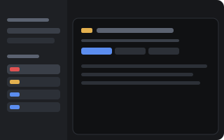

# SecurityHog

Your team's open SecurityHog findings in Herdr's sidebar, with a pane to read one and buttons to fix it in its own worktree and agent, assign it, or ask for a new triage.
Herdr's main layout, with the agents list replaced by the findings, most severe first.
It talks to SecurityHog's MCP server, which is only on PostHog's Tailscale network, and signs in through the browser like Claude Code does.

## What you see

- The left sidebar, 300 px wide, in the `chrome` color: the brand bar (46 px), the spaces list (weight 1), this mod (weight 3), the footer (69 px). The rest of the window is Herdr's main layout unchanged.
- **The header**, 31 px, 11.5 px `dim` text: "Security · 16" (the total open), then two filter pills, the configured team ("team-devex") and "Mine", the chosen one on `selected`. Then how long ago it loaded ("4m", or "Refreshing…") and a refresh button. Without a `team` in the config only "Mine" shows.
- **A finding** is a 46 px row with 8 px corners. Line one is a severity tile (32 by 16 px, 10 px semibold: "Crit" `ansi1`, "High" `ansi3`, "Med" `ansi4`, "Low" and "Info" `dim`, on the same color at 15%) and the title. Line two, 11.5 px `dim`, indented under the title: `POS-643 · posthog` on the left, then on the right:
  - "fixing" (`working`) when a fix's space is open, or "fix started" (`accent`) when it was started here and its space is closed,
  - the triage verdict: "real" (`ansi1`), "unclear" (`ansi3`), "fixed" (`ansi2`), "false +" (`dim`),
  - the assignee: "you" in `accent`, else the part of their email before the @, at most 70 px,
  - its age ("3h", "12d") since the scanner found it.
  The finding shown in the pane has the `selected` background.
- "Show 16 more" loads the next 50 when there are more.
- Instead of rows it says what's missing: "Sign in to SecurityHog." with a "Sign in to SecurityHog" button (`solid`), "Finish signing in in your browser…", "Loading…", "Nothing open for team-devex.", "Nothing open is assigned to you.", or the error in `blocked` (a network error says the server is only on Tailscale). When a refresh fails with a list there, the list stays under "Showing the list from 4m ago." and the error.
- Under 160 px wide it is one 32 by 26 px cell with the number of open findings, in `ansi1` when any is critical or high. A click widens the sidebar to 300 px.
- With `{ "compact": true }` in its layout props, the block is only a 31 px header bar, for a layout that keeps other lists in the sidebar (a 40 px block, like the inbox's compact bar): "Security · 16", "2 high+" in `ansi1` when there are critical or high findings, the team (or "mine"), the age, a list button (`layers` from `workspace-chrome`) and refresh. A click on the title or the list button opens the full list as a 560 by 640 dialog in the `popover` color, with roomier rows (60 px, 5 px between the lines, 4 px between rows, 12 px side padding); a click on a finding there shows it and closes the dialog. Signed out, the age is "Sign in" in `accent`, which starts the sign-in; a failed load says "Failed" in `blocked` with the error as its tooltip. Under 160 px wide it is the count cell, and a click opens the dialog.
- **The finding pane**, a tab named "Security": a header with the severity tile, the title (16 px semibold), and the triage verdict as a tag on the right ("Triage: true positive" in `ansi1`, "Triage: needs a human" in `ansi3`, "Triage: fixed since the scan" in `ansi2`, "Triage: false positive" in `dim`, on its color at 15%). Then a facts line (id, source, status, repository, team, "assigned to you" or the email or "unassigned", "found 12d ago") and buttons:
  - "Fix locally" (primary), or "Go to fix" when a fix was started here ("Open the fix" when its space is closed),
  - "Attach #123" when the fix's branch has a pull request the finding doesn't list,
  - "Assign to me" or "Unassign me",
  - "Request triage" ("Triage running…" and disabled while a run is live),
  - "Open in SecurityHog".
  The current step of a fix ("Creating the worktree…") shows under the buttons in `working`.
  Below, selectable markdown up to 820 px wide: the short description, "Description", "Impact", "Recommendation", "Locations" (GitHub links to the lines), "Triage" (the verdict, confidence, age, commit, summary and reasoning of the latest run), "Fix pull requests", and "Comments" (the newest 20).

## How it behaves

- **The list** is `list_vulnerabilities` with `status: "open"`, `sort: "severity"`, `order: "desc"`, 50 at a time, and `team: [<team>]` or `assignee: ["me"]`. It loads when the sidebar starts, every 10 minutes, after a sign-in, and on the refresh button. The last list is kept in shared state, so rows are there before the first reply, in the dialog too. The filter is kept in shared state.
- **Sign in** runs `shmcp.py login`: it registers the app with SecurityHog once (OAuth dynamic registration, a loopback redirect), opens the browser on SecurityHog's consent page, waits up to 5 minutes for the answer on `127.0.0.1`, and trades the code for a token with PKCE. A sign-in lasts 8 hours. When SecurityHog refuses the token, or it expired, every copy shows the sign-in button again.
- **A click on a finding** shows it in the "Security" tab of the space you're in, or makes that tab. The pane loads `get_vulnerability`.
- **Fix locally**:
  1. Finds your checkout of the finding's repository: `repos` in the config, else one picked before, else it asks with the folder picker and checks the folder's `origin` is that repository.
  2. Fetches the base branch (`origin/HEAD`, else `origin/main`, else `origin/master`) and adds a worktree at `~/.herdr/worktrees/<repo>/<branch>` on a new branch `security/<id>-<title slug>`, made with `--no-track`.
  3. Assigns the finding to you when nobody has it. A failure is a warning, and the fix still starts.
  4. Opens a space in the worktree with the agent (`agent` in the config, default `claude`), named after the finding's id, with a prompt as its first message: the finding's description, impact, recommendation, locations and latest triage, fenced as data, and the instructions to verify it first, fix it with a test, commit on the branch, and keep exploit details out of a pull request.
- **A fix's pull request**: when the pane shows a finding with a fix, it asks `gh pr view` in the worktree. A pull request found is kept, and "Attach #n" calls `attach_fix_pr`.
- **Assign to me** calls `assign_vulnerability_person` with your email (`email` in the config, else `git config --global user.email`). **Request triage** calls `request_triage`. Each one notifies when it's done and reloads the finding.
- Every SecurityHog write follows a click.

## Built from

- `layouts/security.json`: Herdr's `main` layout with the sidebar at 300 px and `sidebar-lists` holding `spaces` (weight 1, min 90) and `{ "mod": "security-hog" }` (weight 3, min 120) where the agents list was. `layouts/security.svg` is its preview.
- `mods/security-hog/`, with `mod.json` `{ "place": "none", "title": "Security" }`. `main.js` picks the view from `props().view`: none is the sidebar (`sidebar.js`, `{ compact: true }` for the bar alone), `list` is the same list in a dialog, `finding` is the pane (`finding.js`, `{ id }` pins it to one finding). `fix.js` has the worktree and agent, `sh.js` the SecurityHog calls, sign-in and config, `ui.js` the shared drawn parts.
- `shmcp.py`: an MCP client and OAuth sign-in in Python's standard library. `login`, `status`, `logout`, `tools`, `call <tool> <json>`. It speaks streamable HTTP to the MCP address in the config's `url`, which this public repo leaves out (SecurityHog's own README has it), and prints JSON, with `{"error", "code"}` and exit 1 on failure (`code: "no_url"` without an address, `"login"` when it needs a sign-in, `"network"` when the server can't be reached).
- `~/.config/security-hog/config.json`: `url` (required), and `team`, `email`, `repos`, `agent`, optional. `~/.config/security-hog/auth.json` (mode 600): the app's client id and the token, read only by `shmcp.py`.
- SecurityHog MCP tools: `list_vulnerabilities`, `get_vulnerability`, `assign_vulnerability_person`, `request_triage`, `attach_fix_pr`.
- Shared state: `security-hog.finding` (the finding the pane shows), `security-hog.list` (the last list loaded), `security-hog.filter`, `security-hog.signin` (`{ state: "waiting" | "in" | "out", at, error }`), `security-hog.fixes` (finding id to `{ repo, repo_path, branch, worktree, pr_url, started_at }`), `security-hog.repos` (checkouts picked with the folder picker).
- `herdr` functions: `exec`, `appHome`, `home`, `readTextFile`, `props`, `theme`, `spaces`, `panes`, `focused`, `shared`, `setShared`, `notify`, `openOverlay`, `closeOverlay`, `knownAgents`, `pickFolder`, `nextCommand`, and `run` with `space.new`, `space.select`, `tab.new`, `tab.select`, `layout.resize`.
- Commands it answers: `security-hog.refresh`.
- Programs: `python3`, `git`, `gh`.
- Art: `refresh.svg` in the mod, and `layers` from the shipped `workspace-chrome` mod.

## Watch out

- The mod reaches the network (SecurityHog's MCP server, as you), runs programs (`python3`, `git`, `gh`), and reads `~/.config/security-hog/`, which is outside its folder.
- The MCP server answers only on the tailnet. Off Tailscale every call fails with a network error.
- SecurityHog accepts only loopback redirects, and issues no refresh tokens: after 8 hours the person signs in again.
- Each sign-in makes an "MCP: Herdr security-hog" token on SecurityHog's API tokens page, which ends it early when deleted.
- Finding text comes from scanners, agents and other people. The fix prompt fences it as data, and the pull request instruction keeps exploit details out of public repositories.
- `herdr-app check` only renders the sidebar. Show the pane as a tab to look at it: `herdr-app do tab.new --mod security-hog --props '{"view":"finding","id":"POS-643"}'`.
- A loop on `nextCommand()` must touch `cx` before acting, or loops from older builds act too.
- It assumes `origin` is the GitHub remote, and Unix paths.

## Done when

- `herdr-app check ~/.config/herdr-app/mods/security-hog` passes.
- `python3 ~/.config/herdr-app/mods/security-hog/shmcp.py login` opens the browser, and after Allow prints `{"ok": true, "expires_at": ...}`; `tools` then lists `list_vulnerabilities`.
- Signed out, the sidebar shows "Sign in to SecurityHog", and the button's sign-in fills the list.
- With `team` set, the list shows that team's open findings, most severe first, and "Mine" switches to yours.
- A click on a finding shows it in the "Security" tab with its description and triage.
- "Fix locally" makes a worktree under `~/.herdr/worktrees/` on a `security/...` branch, and a space in it with the agent working from the prompt. The finding is assigned to you if it wasn't.
