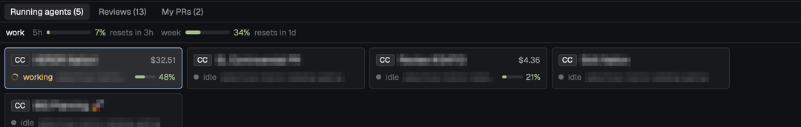
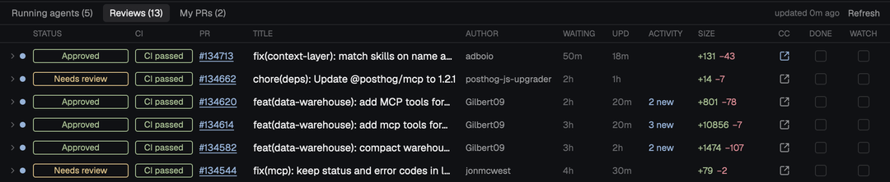
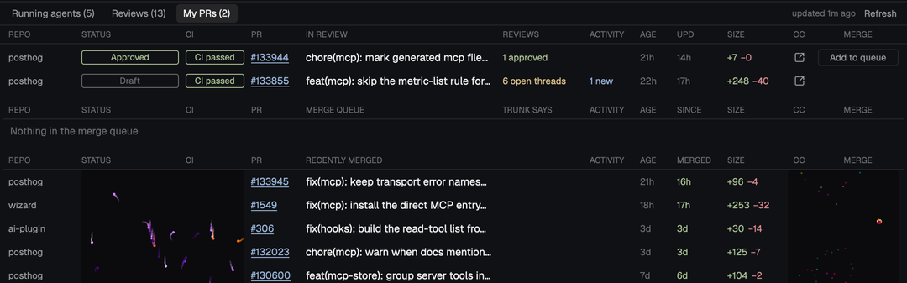

# Squirrel Mode

Jake Ruth's opinionated, ADHD-proof Herdr setup: one top bar and one panel that hold everything that might pull your attention (agents, review requests, your PRs, the merge queue), so nothing slips and nothing nags.
Take the whole thing, or point your agent at one part below and ask for just that.


## Set it up

1. `./install.sh enable squirrel-mode`, then switch to the layout: `herdr-app do layout.switch '{"name":"Squirrel-Mode"}'`.
2. Merge `squirrel-mode/keys.json` into `~/.config/herdr-app/keys.json` by hand. Its bindings only apply while this layout shows.
3. `gh auth login`. Every GitHub view uses the gh CLI and covers every repo your login can see.
4. Optional, for context %, cost and plan limits: set Claude Code's `statusLine` to this piece's script (see [Claude status](#claude-status)).
5. Optional: personal settings in `~/.config/herdr-app/squirrel.json` (see [Settings](#settings)).

> **Not at PostHog?** Three things are PostHog-specific and fail quietly elsewhere: the review button and the standup button ask Claude to load a skill from the PostHog MCP's project skill store (`explaining-prs`, `standup`), and the merge queue table reads the Trunk bot. Point `reviewSkill` and `standupSkill` at skills you have, or ignore those buttons. Everything else works anywhere.

## What you get

### Top bar (`mods/squirrel-topbar/`)


- Tabs on the left, hidden while you only have one. `+`, Changes, GitHub, standup, search, settings on the right.
- **GitHub badge**: the number of PRs waiting on your review that you haven't triaged. Click it for the Reviews view.
- **Standup button** (megaphone): opens a pane below running Claude with your standup skill. A second click jumps to that pane.
- **Glow**: soft neon bands drifting behind the bar, 7 s per colour, with a rim of the normal bar colour. `glow.js`.
- `cmd-w` asks before closing a pane, so a stray key never kills an agent.
- Files: `main.js` (the bar), `github.js` (fetching PRs every 5 minutes, three small GraphQL queries with retries), `glow.js`, `settings.js`.

### Running agents (`mods/squirrel-panel/agents.js`)



- One card per agent: CC or GPT badge, pane name, status, branch, session cost and a context % bar. Click a card to focus it.
- A sub-agent (a terminal another agent started) sits right after its parent with `↳`. One without a pane shows as "+N in background" on the parent; click it to give it a pane.
- **Plan limits strip**: one line per Claude subscription (each Claude config folder), with 5-hour and weekly use and when each resets.
- The panel sizes itself to the rows of cards.

### Reviews (`mods/squirrel-panel/reviews.js`)



- Every open PR where you or one of your teams is a requested reviewer, newest first, PRs that ask for you by name on top (`@you` tag and an accent edge).
- Columns: review status, CI, PR link (turns purple once clicked), title with tags, author, WAITING (red after 48 h), last update, new comments since your last review, size.
- Blue dot: you haven't reviewed it. Ring: new commits since your review. `mentioned`: someone @-mentioned you.
- Click a row (not the link) to unfold who it waits on and the last few human comments.
- **CC**: opens a pane below running Claude with your review skill on that PR. A second click jumps to that pane.
- **DONE**: hide it for good. **WATCH**: hide it until new commits, a new comment or a new request, then it comes back on top with an amber `↻` tag. The row shows the tick, then fades out. Ticking the last one plays confetti (`mods/squirrel-confetti/`).
- At most 10 rows show; the rest scroll under a sticky header.

### My PRs (`mods/squirrel-panel/my-prs.js`)



- Three tables on one column grid: **In review** (your open PRs in any repo), **Merge queue** (where each one stands in Trunk, from the Trunk bot's comment) and **Recently merged** (the last 7 days).
- **Add to queue** and **Remove** run `trunk merge` and `trunk merge cancel` from your PostHog checkout. The first click arms the button; a second within 4 s runs it. Needs `trunk login` once.
- The empty cells of merged rows are a visualizer: two live simulations (flow fields, a spectrum analyser, warp stars, orbs, rain, fireworks, Game of Life, random walkers, plasma) with random palettes, swapping every 9 to 17 s. `visualizer.js`.

### The rest

- `mods/squirrel-pane-header/`: pane headers with the pane's name, folder, and split, zoom and close buttons.
- `mods/squirrel-rename/`: `cmd-r` names the focused pane. Herdr only names tabs, so names live in shared state.
- `mods/squirrel-new-menu/`: the `+` menu.
- `layouts/Squirrel-Mode.json`: the top bar, the panel under it (`agents-panel`), then panes with Herdr's Files and Changes column on the right. No spaces list: this setup lives in one space.

## Keys

| Key | Does |
| --- | --- |
| `cmd-1` / `cmd-2` / `cmd-3` | Running agents / Reviews / My PRs, showing the panel if it's hidden |
| `cmd-b` | Show or hide the panel |
| `cmd-t`, `cmd-shift-d` | New pane below, straight into Claude (no shell start-up) |
| `cmd-shift-t` | New tab |
| `cmd-r` | Rename the focused pane |
| `cmd-w` | Close the focused pane, after asking |

## Settings

`~/.config/herdr-app/squirrel.json` is yours: `install.sh` never touches it. Every key is optional.

```json
{
  "reviewSkill": "explaining-prs",
  "standupSkill": "standup",
  "standupCommand": ["env", "CLAUDE_CONFIG_DIR=~/.claude-personal", "claude"],
  "posthogCheckout": "~/code/posthog",
  "mergedDays": 7,
  "accountNames": { "/Users/you/.claude": "work", "/Users/you/.claude-personal": "personal" }
}
```

- `reviewSkill`, `standupSkill`: project skills the CC and standup buttons ask Claude to load from the PostHog MCP.
- `standupCommand`: how the standup pane starts Claude. Defaults to `["claude"]`; the example uses a second Claude subscription.
- `posthogCheckout`: where `trunk` runs. Uses that checkout's flox `trunk` when there is one, else `trunk` on your PATH.
- `accountNames`: labels for the plan limits strip, keyed by Claude config folder.

## Claude status

Context %, session cost and plan limits come from Claude Code's statusline input. Set `statusLine` in each Claude config you use (`~/.claude/settings.json`, and any other `CLAUDE_CONFIG_DIR`):

```json
"statusLine": { "type": "command", "command": "sh ~/.config/herdr-app/mods/squirrel-panel/statusline.sh", "padding": 0 }
```

- The script saves what Claude passes in to `~/.config/herdr-app/data/squirrel/context/<terminal>.json`, prints nothing, and then runs the command in `~/.config/herdr-app/data/squirrel/next-command` if that file exists.
- To keep your own statusline, put its command in `next-command`.
- With the `claude-usage` piece: connect it after setting this script, and its wrapper runs this script for you. If you connected `claude-usage` first, put its command in `next-command`.

## For agents changing this

- Shared state keys: `squirrel.github` (PR lists, written by the top bar), `squirrel.triaged`, `squirrel.visited`, `squirrel.view`, `squirrel.pane-names`, `squirrel.review-panes`, `squirrel.standup-pane`, `squirrel.settings`.
- The top bar owns fetching. The panel only reads `squirrel.github`, so a different fetcher can feed it.
- Panel views are mixins on one `View`: `agents.js`, `reviews.js`, `my-prs.js`, with `table.js` for the shared cells and `shared.js` for constants.
