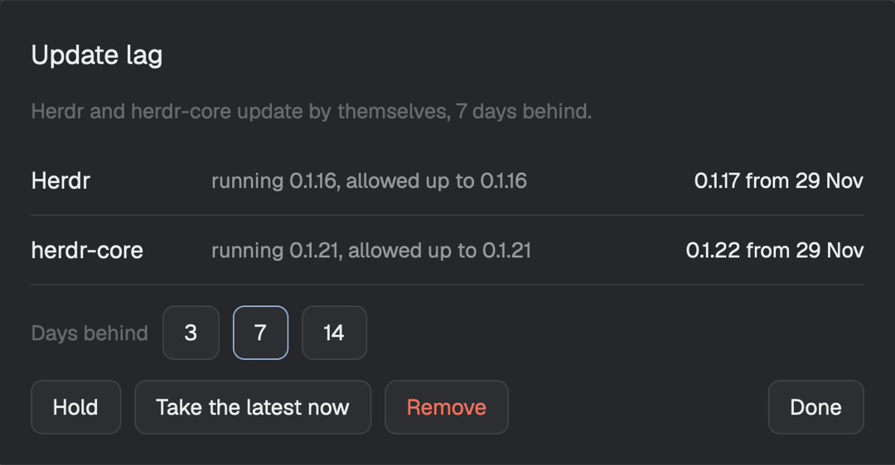

# Update lag

Keeps Herdr and herdr-core a few days behind the newest release, while they still update by themselves.

Herdr has one release feed. It downloads every release as soon as it ships and installs it on the next quit, and it has no setting to wait or to turn that off ([herdr-app#207](https://github.com/herdrdev/herdr-app/issues/207)).
This piece makes Herdr see a release only once it has been public for 7 days (or 3, or 14), so a bad release has time to be noticed and pulled before it reaches you.
macOS on Apple Silicon only.

## What you see

Nothing in the window. A dialog, 540 px wide, opens with `cmd-shift-u` once you merge `keys.json`, or with `herdr-app do mod.open --name update-lag`.

- **Before it is set up:** three lines that say what Herdr does today, what the lag changes and what it adds to your Mac, then **Set up** and **Done**.
- **Once set up**, top to bottom:
  - "Update lag" in 16 px semibold, with a spinner on its right while something runs.
  - One 12.5 px `dim` line: "Herdr and herdr-core update by themselves, 7 days behind." On hold it says so in `ansi3`.
  - A warning in `ansi3` when the open window started before the setup, so it still reads the live feed: "Quit and reopen Herdr to start."
  - One row each for Herdr and herdr-core: the name, "running 0.1.16, allowed up to 0.1.16" in `muted`, and on the right the newest release that waits and the day it is let through, "0.1.17 from 29 Nov", or "nothing newer is waiting" in `dim`.
  - "Days behind" with three buttons, 3, 7 and 14. The current one has an `accent` border.
  - Buttons: **Hold** (or **Resume**), **Take the latest now**, **Remove** in `blocked`, and **Done** on the right.

## How it behaves

- **Set up** records the versions you run as already allowed, starts a background job for your user, and sets `HERDR_RELEASES_URL` for apps you open from then on. Quit and reopen Herdr once: your terminals keep running.
- Every 30 minutes, and at login, the job:
  - records upstream's newest Herdr and herdr-core release, with the time it first saw each;
  - marks a release it recorded as withdrawn when upstream's latest goes back below it. A withdrawn release is never let through, unless upstream offers it again;
  - lets the newest release that is old enough through to the mirror. First it downloads the macOS build and checks it against the sha256 it recorded on the first day, and against Herdr's Developer ID (team `2W9652Q7QR`, with the app's or the core's identifier). For herdr-core that covers both `Herdr Core.app` and the bare `herdr-core` beside it, which `install.sh` and older cores install. A build that fails a check is never let through and is not downloaded again; the log and `lag.py status` say why, and the newest older release that passes goes through instead;
  - holds a Herdr release back until the mirror's herdr-core meets the `core_min` it asks for;
  - removes a Herdr update that is downloaded and waiting to install, when it is newer than the mirror allows. That covers a Herdr that started without the variable.
- Herdr then updates as it always does, from the mirror: it downloads what the mirror names and installs it on the next quit. The first start after a Herdr update also updates herdr-core, to the mirror's version.
  It does that by running the mirror's `core/install.sh` with `HC_VERSION`, which reads `core/<version>/manifest.json`. So each herdr-core let through also writes upstream's `install.sh` and its versioned manifest to the mirror. `HC_VERSION` means "at least this one", so a recorded core version, or an app's `core_min`, that the mirror never offered itself gets the manifest of the newest one it allows.
- **Set up** stops, and unsets the variable, when the mirror can't offer the versions you run, for example when a download or a check fails. The job sets the variable only once the mirror has both feeds, `core/install.sh` and the core's versioned manifest.
- Only one `lag.py` changes the mirror at a time: the job and the dialog's buttons wait for each other's lock (`lock` in the folder below). **Hold** takes effect even while a release is being checked.
- **Days behind** changes the lag at once. A shorter lag can let a waiting release through on the spot. A longer one never takes back a release that is already allowed.
- **Hold** stops every release until **Resume**. The job still records what ships.
- **Take the latest now** needs a second click, which names the versions. It lets upstream's newest through after the same two checks, for an urgent fix. Nothing takes it back afterwards.
- **Remove** needs a second click. It stops the job and unsets the variable. Herdr reads the live feed again after you reopen it. The record of what was seen stays, so setting it up again keeps the dates.
- The dialog reads the state when it opens and after each button. It does not poll.

## Built from

- `mods/update-lag/main.js`: the dialog, a `View`. It calls `updates()` from `herdr` for the versions you run, and runs `lag.py` with `exec("/usr/bin/python3", ["-I", ...])`.
- `mods/update-lag/lag.py`: everything else, in Python's standard library. `install`, `uninstall`, `sync`, `status [--json]`, `set-lag N`, `hold`, `resume`. It runs `curl`, `tar`, `codesign`, `launchctl`, `pgrep` and `ps`.
- `mod.json`: `{ "place": "none", "overlay": { "kind": "dialog", "width": 540 } }`, so it only shows as that dialog.
- `keys.json`: `cmd-shift-u` opens it.
- Outside Herdr's folder:
  - `~/Library/LaunchAgents/com.user.herdr-lagged-releases.plist`, the job, which runs `lag.py sync`;
  - `~/.local/share/herdr-lagged-releases/`: `mirror/` (the feed Herdr reads: `app/latest.json`, `core/latest.json`, `core/install.sh` and `core/<version>/manifest.json`), `seen/` (each release's manifest, when it was first seen, and whether it was withdrawn or failed a check), `sync.log`, `lag_days`, `hold` and `lock`.
- The mirror is a `file://` URL. Herdr and herdr-core fetch their feed with curl, so that works. The downloads themselves still come from Herdr's release host.
- It reaches the network: `releases.herdr.dev`, twice per run for the two manifests, once per release for the download it checks, and once per herdr-core let through for `install.sh`.

## Watch out

- A delay only helps when someone notices a bad release inside the window. It is a buffer, not a review.
- Security fixes arrive late too. Use **Take the latest now** for one you need.
- The job polls. A release that upstream replaces between two runs is never recorded, so it is skipped, not delayed.
- `core/install.sh` is copied from upstream when a herdr-core is let through, without a wait of its own. It is the script Herdr runs from upstream without this piece. Pointed at a mirror, it skips its own signature check, so the check here is the one that counts.
- A release that failed a check stays refused. To try it again, delete its file under `seen/`: the next run records it again as new.
- A release withdrawn after it was let through stays in the mirror. Hold, then Remove, if you need to go back.
- The lag counts from when your Mac first saw a release, not from its release date. On the day you set it up, the newest release starts its wait from that day.
- `hc update` typed in a terminal uses that shell's environment. Without `HERDR_RELEASES_URL` there, it goes to the live feed.
- The variable is set with `launchctl setenv`, which lasts until you log out. The job sets it again at login. If Herdr opens before the job has run, it reads the live feed for that launch: the job then removes what it downloaded, within 30 minutes, and the dialog shows the warning.
- The job runs the copy of `lag.py` in Herdr's config folder. Remove the lag before you disable the piece, or the job is left pointing at a file that is gone.
- Herdr's own updater does not require Herdr's signature on an app update, so the checks here are stricter than upstream's. They only cover what goes through the mirror.
- Linux and Windows: the dialog says it does not work there. The script's checks are `codesign` and `launchctl`.
